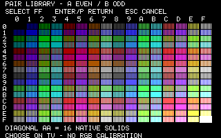

# Pairbrush

A small DOS paint app for Chad's Tandy 1000 EX and Sony WEGA setup. Paint with all 256 ordered pairs of the 16 native colors on a 160 x 200 two-pixel-cell canvas.

Pairbrush supports mouse and keyboard painting, color picking, 1/2/4/8-cell brushes, a panning toolbar view, full canvas view, whole-stroke undo/redo, and checked `.TDP` save/load files. Choose colors on the actual display; no composite-color calibration is assumed.

Historical DOSBox-X renderer capture from the production-source test fixture with synthetic input. This is an emulator image; actual composite colors depend on the display.

## Build and run

This source repository preserves the final R2 source from 2026-10-13 without changing the app. Build using Microsoft C 6.0 and DOS LINK; see [build instructions](docs/BUILD.md). Compiler tools and compiled executables are not bundled.

Run the built `PAINT.EXE` in plain Tandy DOS 3+, starting in mode 3, with 640 KB installed (624 KB reported by BIOS). Exit Windows first. A DOS mouse driver is optional; `PAINT /NOMOUSE` uses keyboard controls. This revision uses Tandy mode 9 and has no ordinary IBM CGA backend.

See [controls and file format](docs/USER-GUIDE.md). Host checks are available through `scripts/test-host.ps1`; run `python scripts/verify-source.py` to check the source against the recorded R2 hashes.

## License and credits

Chad selected [MIT](LICENSE) for Pairbrush's original code. [Credits](docs/CREDITS.md) record the development tools and historical material. The existing R2 source has been retained, including its small 5x7 glyph table.

The local preparation passed 1,532,777 document assertions, 27 allocation checks and 54,733 UI assertions. The original R2 records a successful MSC6/DOSBox-X target build; a new target build has not been run during repository preparation. Real hardware speed and TV color appearance remain to be assessed on the target setup.
